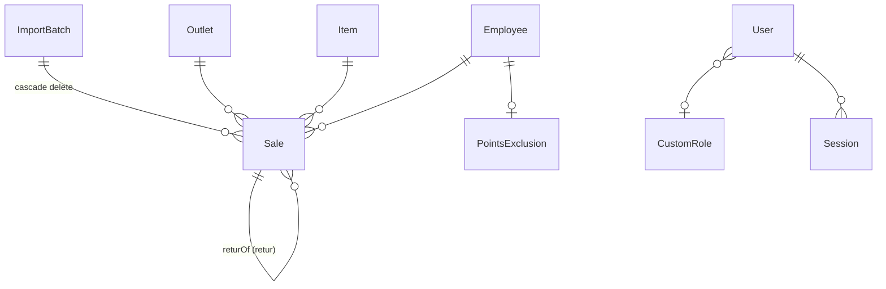
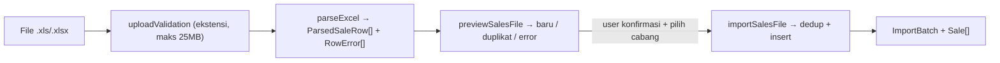

# Blueprint Website Analisa Penjualan — Versi Tanpa Tarik Tunai (Tartun) & Server

> Nama kerja: **"AnalisaBEe Lite"** (silakan ganti). Blueprint ini diturunkan langsung dari kode AnalisaBEe yang sekarang berjalan (`prisma/schema.prisma`, `src/server/routes/*`, `src/lib/queries/*`, `src/pages/*`). **Semua fitur sama**, kecuali seluruh hal yang berkaitan dengan **Tarik Tunai (Tartun)** dan **Komisi Server** dihapus: tidak ada import-nya, tidak ada tabelnya, tidak ada target-nya, dan tidak ikut dihitung di mana pun.

---

## 0. Ringkasan Perbedaan dengan Website Sekarang

| Area | Website sekarang | Website baru |
|---|---|---|
| Lini bisnis target | 5: Server, Tartun, Petshop, Aksesoris, SP/Voucher | **3: Petshop, Aksesoris, SP/Voucher** |
| Tabel DB | `TartunDaily`, `ServerDaily`, `OutletAlias` | **Dihapus** |
| Enum | `BusinessLine` (5 nilai) + `ReportCategory` (3 nilai) | **Hanya `ReportCategory`** (dipakai juga oleh `Target`) |
| Import & Batch | Penjualan + Retur + Tartun/Server (upload/tempel teks) | **Penjualan + Retur saja** |
| Laporan Target Harian | 13 kolom (5 lini × Sales/Trx + total) | **9 kolom** (3 lini × Laba/Pcs + total) |
| Analitik Eksekutif | Pie/Bar 5 lini | **Pie/Bar 3 lini** |
| Analisa Data | Gabungan 3 sumber (Sale, Tartun, Server) | **1 sumber: Sale** (penjualan + retur) |
| Pengaturan | Ada panel "Alias Outlet" + target 5 lini | **Panel Alias Outlet dihapus**, target 3 lini |
| Backup data | Termasuk Tartun/Server | **Tanpa Tartun/Server** |
| Endpoint API | `/api/import/tartun`, `/api/import/server`, `/api/daily-imports/*`, `/api/mappings/outlet-alias*` | **Dihapus** |
| File kode | `parseTartunServer.ts`, `importTartunServer.ts`, `TartunServerImport.tsx`, `defaults/outletAliases.ts` | **Tidak dibuat** |

Total pendapatan/omzet yang ditampilkan di seluruh aplikasi **hanya** berasal dari baris `Sale` (export POS).

---

## 1. Tujuan & Prinsip

**Masalah:** data POS keluar sebagai file Excel per periode; tanpa alat bantu tidak bisa dibandingkan lintas bulan atau ditelusuri per item/outlet/pegawai.

**Prinsip (dipertahankan dari versi sekarang):**
1. **Akumulatif, bukan overwrite** — setiap import menambah data; file sama boleh diunggah ulang (dedup `rowHash`).
2. **Angka mentah disimpan apa adanya** — `Sale` = 1 baris Excel. Margin, poin, capaian target dihitung saat query.
3. **Aturan bisnis bisa diubah tanpa deploy** — target, mapping kategori, poin item disimpan di DB & diedit lewat Pengaturan.
4. **Jangan tampilkan angka tanpa data pendukung** — tidak ada placeholder.
5. **Data kritis tidak boleh hilang diam-diam** — Postgres di bind-mount, backup terjadwal.

---

## 2. Tech Stack

| Lapisan | Teknologi |
|---|---|
| Frontend | Vite + React 19 SPA, `react-router-dom` v7, lazy-load per halaman |
| State/data fetching | `@tanstack/react-query` (halaman tersibuk), sisanya `fetch` |
| UI | Tailwind CSS v4 (`@theme inline`), Recharts v3, `html2canvas-pro` (export JPEG) |
| Backend | Node.js + Express 5 (satu proses), `helmet`, `compression`, `express-rate-limit`, `cookie-parser`, `multer` |
| ORM / DB | Prisma 7 + `@prisma/adapter-pg`, PostgreSQL |
| Auth | Tabel `User`/`Session` sendiri, password `scrypt`, JWT (`jose`) berisi session id |
| Excel | `xlsx` (SheetJS) — server-side import, client-side export |
| Validasi | inline per route (opsional: `zod`) |
| Test | Vitest |
| Deploy | Docker + docker-compose (self-hosted/NAS, akses via Tailscale) |

**Dev:** `npm run dev` → Vite (port 3000) + API `tsx watch` (port 3001), Vite proxy `/api/*`.
**Prod:** `npm start` → Express men-serve `dist/` + API di satu port.

---

## 3. Struktur Direktori

```
src/
├── main.tsx, App.tsx              # Entry + semua route
├── pages/
│   ├── DashboardPage.tsx          # dipakai Bandung & Cimahi (prop branch)
│   ├── LoginPage.tsx
│   ├── target/                    # TargetLayout, TargetReportPage, AnalitikPage, JamOperasionalPage
│   ├── points/                    # PointsLayout, PointsLeaderboardPage
│   ├── cimahi/CimahiLayout.tsx
│   ├── items/                     # ItemsPage, ItemsByCategoryPage
│   ├── outlets/                   # OutletsPage, OutletDetailPage
│   ├── employees/                 # EmployeesPage, EmployeeDetailPage
│   ├── transactions/TransactionsPage.tsx
│   ├── dataexplorer/DataExplorerPage.tsx
│   ├── import/ImportPage.tsx
│   ├── log/ActivityLogPage.tsx
│   ├── settings/SettingsPage.tsx  # (disarankan dipecah per panel)
│   └── public/EmployeePointsDashboardPage.tsx
├── components/                    # AppLayout, Sidebar, Topbar, ThemeToggle, SortableTable,
│                                  # StatCard, SparkKpiCard, TrendChart, RevenueAreaChart,
│                                  # Leaderboard, ItemPicker, ConfirmDeleteModal,
│                                  # ImportPreviewPanel, SalesReturnImport,
│                                  # MasterItemImport, PointRulesExcelImport
├── context/                       # AuthContext, ThemeContext, PeriodContext, MenuVisibilityContext
├── hooks/                         # useOutlets, usePointsSettings
├── server/
│   ├── index.ts, middleware.ts, uploads.ts
│   └── routes/                    # auth, accounts, roles, backup, dashboard, outlets, employees,
│                                  # items, sales, dataExplorer, target, points, publicPoints,
│                                  # mappings, imports, masterItems, menuVisibility, activityLog
└── lib/
    ├── prisma.ts, session.ts, password.ts, permissions.ts, features.ts, sidebarMenus.ts
    ├── ensureDefaults.ts, backup.ts, format.ts, csv.ts, csvSafe.ts, hash.ts, dateDefaults.ts
    ├── parseExcel.ts, importSales.ts           # import penjualan
    ├── parseSalesReturn.ts, importSalesReturn.ts # import retur
    ├── parseMasterItems.ts, parsePointExcel.ts
    ├── uploadValidation.ts, parseSalesFilterParams.ts, useMonthPeriod.ts
    ├── defaults/                  # targets.ts, itemGroupMapping.ts, itemPoints.ts (TANPA outletAliases.ts)
    └── queries/                   # _hiddenItems, dashboard, targetReport, hourly, items, outlets,
                                   # employees, sales, dataExplorer, points, mappings, roles, users, systemStatus
```

**Aturan:** `src/pages` & `src/components` **tidak boleh** import `prisma`. Semua akses data lewat `fetch("/api/...")`.

---

## 4. Model Data (Prisma Schema)

### 4.1 Diagram relasi



Tabel konfigurasi (berdiri sendiri): `Target`, `ItemGroupMapping`, `PointGroupMapping`, `ItemPoint`, `ItemPointExclusion`, `ItemGroupPointDefault`, `PointSettings` (singleton id=1), `ActivityLog`.

### 4.2 Enum

```prisma
enum ImportStatus   { PROCESSING DONE FAILED }
enum Branch         { BANDUNG CIMAHI }
enum TargetScope    { PERKONTER ALL }
enum ReportCategory { PETSHOP AKSESORIS SP_VOUCHER }   // juga dipakai Target.category
// BusinessLine DIHAPUS (dulu berisi SERVER & TARTUN)
```

### 4.3 Schema lengkap

```prisma
model ImportBatch {
  id             Int          @id @default(autoincrement())
  filename       String
  uploadedAt     DateTime     @default(now())
  status         ImportStatus @default(PROCESSING)
  rowCount       Int          @default(0)
  insertedCount  Int          @default(0)
  duplicateCount Int          @default(0)
  errorRowCount  Int          @default(0)
  errorMessage   String?
  periodStart    DateTime?    @db.Date
  periodEnd      DateTime?    @db.Date
  branch         Branch       @default(BANDUNG)
  isRetur        Boolean      @default(false)
  sales          Sale[]
  @@map("import_batches")
}

model Outlet {
  id       Int     @id @default(autoincrement())
  name     String  @unique
  isHidden Boolean @default(false)
  branch   Branch  @default(BANDUNG)
  sales    Sale[]
  // TIDAK ADA: aliases, tartun, server
  @@map("outlets")
}

model Target {
  id        Int            @id @default(autoincrement())
  scope     TargetScope
  category  ReportCategory            // hanya PETSHOP / AKSESORIS / SP_VOUCHER
  branch    Branch         @default(BANDUNG)
  amount    Decimal        @db.Decimal(14, 2)
  updatedAt DateTime       @updatedAt
  @@unique([scope, category, branch])
  @@map("targets")
}

model ItemGroupMapping {        // Item Group POS -> kategori laporan Target Harian & Kategori Item
  id        Int            @id @default(autoincrement())
  itemGroup String         @unique
  category  ReportCategory
  isDefault Boolean        @default(false)
  createdAt DateTime       @default(now())
  @@map("item_group_mappings")
}

model PointGroupMapping {       // Item Group POS -> kategori leaderboard poin (independen)
  id        Int            @id @default(autoincrement())
  itemGroup String         @unique
  category  ReportCategory
  isDefault Boolean        @default(false)
  createdAt DateTime       @default(now())
  @@map("point_group_mappings")
}

model Item {
  id                Int     @id @default(autoincrement())
  code              String
  name              String
  itemGroup         String?
  brand             String?
  branch            Branch  @default(BANDUNG)
  isHidden          Boolean @default(false)
  isFromSalesImport Boolean @default(false)
  sales             Sale[]
  @@unique([code, branch])       // unik PER CABANG, bukan global
  @@index([name])
  @@map("items")
}

model ItemPoint {
  id        Int      @id @default(autoincrement())
  pattern   String
  points    Int
  startDate DateTime @default(now()) @db.Date   // berlaku mulai tanggal
  isDefault Boolean  @default(false)
  updatedAt DateTime @updatedAt
  @@unique([pattern, startDate])
  @@index([pattern])
  @@index([startDate])
  @@map("item_points")
}

model ItemPointExclusion {
  id        Int      @id @default(autoincrement())
  pattern   String   @unique
  createdAt DateTime @default(now())
  @@map("item_point_exclusions")
}

model ItemGroupPointDefault {
  id        Int      @id @default(autoincrement())
  itemGroup String   @unique
  points    Int
  updatedAt DateTime @updatedAt
  @@map("item_group_point_defaults")
}

model PointSettings {
  id                 Int      @id @default(1)
  periodStartDay     Int      @default(1)
  pointTargetMonthly Int      @default(0)
  pointTargetWeekly  Int      @default(0)
  pointTargetDaily   Int      @default(0)
  pointRupiahRate    Int      @default(100)
  hiddenMenuItems    String[] @default([])
  @@map("point_settings")
}

model Employee {
  id       Int              @id @default(autoincrement())
  name     String           @unique
  isHidden Boolean          @default(false)
  sales    Sale[]
  excluded PointsExclusion?
  @@map("employees")
}

model PointsExclusion {
  id         Int      @id @default(autoincrement())
  employeeId Int      @unique
  employee   Employee @relation(fields: [employeeId], references: [id])
  reason     String?
  createdAt  DateTime @default(now())
  @@map("points_exclusions")
}

model Sale {
  id            Int      @id @default(autoincrement())
  noTransaksi   String
  tanggal       DateTime @db.Date
  jamBuat       String                 // "HH:MM:SS"
  customer      String
  qty           Int
  unit          String
  hargaJual     Decimal  @db.Decimal(14, 4)
  diskon        Decimal  @db.Decimal(14, 4)
  subtotal      Decimal  @db.Decimal(14, 4)   // = OMZET
  hpp           Decimal  @db.Decimal(14, 4)
  labaRugi      Decimal  @db.Decimal(14, 4)   // = LABA
  rowHash       String   @unique              // sha256 seluruh kolom -> dedup
  isRetur       Boolean  @default(false)      // baris retur: qty/subtotal/hpp/laba NEGATIF
  returOfSaleId Int?
  returOf       Sale?    @relation("SaleReturns", fields: [returOfSaleId], references: [id])
  returns       Sale[]   @relation("SaleReturns")
  outletId      Int
  outlet        Outlet      @relation(fields: [outletId], references: [id])
  itemId        Int
  item          Item        @relation(fields: [itemId], references: [id])
  employeeId    Int
  employee      Employee    @relation(fields: [employeeId], references: [id])
  importId      Int
  import        ImportBatch @relation(fields: [importId], references: [id], onDelete: Cascade)
  @@index([itemId, tanggal])
  @@index([outletId, tanggal])
  @@index([tanggal])
  @@index([employeeId, tanggal])
  @@index([noTransaksi])
  @@map("sales")
}

model ActivityLog {
  id        Int      @id @default(autoincrement())
  role      String
  action    String
  detail    String?
  ip        String?
  createdAt DateTime @default(now())
  @@index([createdAt])
  @@map("activity_logs")
}

model User {
  id           Int         @id @default(autoincrement())
  username     String      @unique
  displayName  String?
  passwordHash String
  role         String      @default("admin")   // "master" | "admin"
  roleId       Int?
  customRole   CustomRole? @relation(fields: [roleId], references: [id], onDelete: SetNull)
  isActive     Boolean     @default(true)
  createdAt    DateTime    @default(now())
  updatedAt    DateTime    @updatedAt
  lastLoginAt  DateTime?
  sessions     Session[]
  @@map("users")
}

model CustomRole {
  id          Int      @id @default(autoincrement())
  name        String   @unique
  permissions String[] @default([])   // daftar FeatureKey
  createdAt   DateTime @default(now())
  updatedAt   DateTime @updatedAt
  users       User[]
  @@map("custom_roles")
}

model Session {
  id         Int       @id @default(autoincrement())
  tokenHash  String    @unique        // SHA-256 token, bukan token mentah
  userId     Int?
  user       User?     @relation(fields: [userId], references: [id], onDelete: Cascade)
  username   String
  role       String
  ip         String?
  userAgent  String?
  createdAt  DateTime  @default(now())
  lastSeenAt DateTime  @default(now())
  expiresAt  DateTime
  revokedAt  DateTime?
  @@index([userId])
  @@index([expiresAt])
  @@map("sessions")
}
```

---

## 5. Pipeline Import (hanya 3 jenis)

### 5a. Import Penjualan (akumulatif)



**Kolom wajib Excel POS:** `No Transaksi`, `Tanggal`, `Jam Buat`, `Cabang`, `Kode Item`, `Nama Item`, `qty`, `unit`, `Harga Jual`, `Diskon`, `Subtotal`, `HPP`, `Laba Rugi`, `Pegawai`. Opsional: `Customer`, `Item Group`.

- **Dedup:** `rowHash = sha256(seluruh kolom + nomor kemunculan)` → file yang sama/tumpang-tindih tidak dobel.
- `Cabang` kosong → diinferensikan dari riwayat pegawai.
- Outlet baru dibuat otomatis dengan branch sesuai pilihan; **outlet lama tidak boleh dipindah branch oleh import** (hanya lewat Pengaturan).
- Kode item belum ada di cabang itu → buat `Item` dengan `isFromSalesImport=true`.
- `Pegawai` kosong → "Tidak diketahui".

### 5b. Import Retur Penjualan

Kolom wajib (sheet "Table List"): `No.Retur`, `Tanggal`, `Nama Customer`, `Kode Item`, `Nama Item`, `Qty`, `Satuan`, `Harga`, `No.Penjualan`, `Cabang`.

- Dicocokkan **persis** ke `Sale` asli via `No.Penjualan` (= `Sale.noTransaksi`) + kode item per cabang.
- Ketemu → outlet/pegawai/HPP diwarisi dari transaksi asli (HPP diprorata jika retur sebagian), `returOfSaleId` diisi.
- Tidak ketemu → outlet dari kolom `Cabang`, pegawai "Tidak diketahui".
- Disimpan sebagai `Sale` baru: `isRetur=true`, qty/subtotal/hpp/labaRugi **negatif**, `noTransaksi` = nomor retur (`SE...`). Otomatis mengurangi omzet/laba/poin di semua agregat tanpa mengubah query.
- Batch: `ImportBatch.isRetur = true`. Juga lewat pratinjau dulu.

### 5c. Import Master Item (katalog per cabang, overwrite) — di Pengaturan

Kolom wajib: `Kode Item`, `Nama Item`; opsional `Item Grup`, `Merk`. Upsert per `(code, branch)`, clear `isFromSalesImport`. Satu-satunya sumber kebenaran nama/kategori/merk item.

> ❌ **Tidak ada** import Tarik Tunai, Komisi Server, maupun tempel-teks ringkasan harian.

---

## 6. Aturan Domain

### 6.1 Definisi angka
| Istilah | Sumber |
|---|---|
| Omzet | `SUM(Sale.subtotal)` |
| Laba | `SUM(Sale.labaRugi)` |
| Qty | `SUM(Sale.qty)` |
| Transaksi | jumlah baris `Sale` (atau distinct `noTransaksi`, sesuai halaman) |
| Kategori | `Item.itemGroup` → `ItemGroupMapping.category` |

Semua angka sudah net retur karena baris retur bernilai negatif.

### 6.2 Target Harian — diukur terhadap **LABA**, hanya 3 lini

- `Target` per `(scope, category, branch)`:
  - `PERKONTER` = ambang lolos/tidak per outlet.
  - `ALL` = total jaringan untuk % capaian.
- Nilai default (`defaults/targets.ts`):

| Scope | PETSHOP | AKSESORIS | SP_VOUCHER |
|---|---|---|---|
| PERKONTER | 35.000 | 35.000 | 100.000 |
| ALL | 1.190.000 | 1.400.000 | 4.000.000 |

- Realisasi per outlet per lini = `SUM(labaRugi)` & `SUM(qty)` dari `Sale` yang item group-nya terpetakan ke lini tersebut.
- Item group yang belum terpetakan → dikembalikan sebagai `unmappedItemGroups` (ditampilkan sebagai peringatan).
- Rentang tanggal: target × `dayCount` (inklusif) di server, supaya apple-to-apple.
- `totalSales = petshop + aksesoris + spVoucher`; `totalTargetAll = ALL.PETSHOP + ALL.AKSESORIS + ALL.SP_VOUCHER`.
- **Capaian (%) = realisasi / target ALL × 100.** Status sel = `good` jika ≥ PERKONTER, `bad` jika kurang.
- Dashboard: baseline target (`labaTargetPerDay` = Σ target ALL 3 lini) hanya ditampilkan di metrik Laba.

### 6.3 Sistem Poin — urutan prioritas (fungsi murni `computeItemPoints`)
```
1. ItemPointExclusion cocok        → 0 poin (selalu menang)
2. ItemPoint pattern cocok          → poin aturan (pola TERPANJANG menang,
                                      memperhatikan startDate ≤ tanggal transaksi)
3. ItemGroupPointDefault ada        → poin default kategori
4. selain itu                       → 0
```
Pencocokan pattern = substring case-insensitive pada `Item.name` (aman untuk varian warna). Pegawai di `PointsExclusion` tidak muncul di leaderboard. Kategori leaderboard (Aksesoris/Petshop/SP) memakai `PointGroupMapping`. Insentif = total poin × `pointRupiahRate` (internal saja, tidak di papan publik).

### 6.4 Periode bulanan kustom
`PointSettings.periodStartDay` (1–31). `computeMonthPeriod(2026, 9, 29)` = **29 Sep – 28 Okt** (dinamai bulan saat periode dimulai). Mode periode: Harian / Mingguan (`computeWeekPeriod`) / Bulanan.

### 6.5 Item/Outlet/Pegawai tersembunyi
`isHidden=true` → dikecualikan dari **semua** agregat (helper `EXCLUDE_HIDDEN_ITEMS`), kecuali halaman detail item itu sendiri, drill-down transaksi dengan filter item eksplisit, dan panel Visibilitas di Pengaturan. Data tidak dihapus.

### 6.6 `ensureDefaults(branch)`
Seed idempoten (upsert) untuk: target 3 lini, mapping item group, daftar poin item, poin default kategori. Dipanggil saat server start & di awal query yang membutuhkan. **Tidak** ada seed alias outlet.

---

## 7. Peta Halaman & Fitur

### 7.1 Sidebar

```mermaid
flowchart TD
    S["Sidebar"] --> B["Cabang Bandung"]
    S --> C["Cabang Cimahi"]
    S --> D["Dimensi Analisis"]
    S --> M["Manajemen Data & Sistem"]
    B --> B1["Dashboard /dashboard"]
    B --> B2["Target Harian /target"]
    B --> B3["Poin Aksesoris /points"]
    B --> B4["Poin Petshop /points/petshop"]
    B --> B5["Poin SP/Voucher /points/sp"]
    B --> B6["Papan Poin TV /papan-poin"]
    C --> C1["Dashboard /cimahi/dashboard"]
    C --> C2["Target Harian /cimahi/target"]
    C --> C3["Poin Aksesoris/Petshop/SP /cimahi/points..."]
    C --> C4["Papan Poin TV /papan-poin/cimahi"]
    D --> D1["Item & SKU /items"]
    D --> D2["Kategori Item /items/categories"]
    D --> D3["Performa Outlet /outlets"]
    D --> D4["Pegawai & Staff /employees"]
    D --> D5["Daftar Transaksi /transactions"]
    M --> M1["Import & Batch /import"]
    M --> M2["Analisa Data /analisa-data"]
    M --> M3["Log Aktivitas /log"]
    M --> M4["Pengaturan /settings (master)"]
```



Cimahi memakai **komponen yang sama** dengan prop `branch="CIMAHI"`. Menu bisa disembunyikan oleh master (`PointSettings.hiddenMenuItems`), kecuali `/settings` (required).

### 7.2 Detail per halaman

#### Login — `/login`
Username + password; fallback break-glass dari `.env` (`MASTER_PASSWORD`/`ADMIN_PASSWORD`). Satu pesan error generik. Rate-limited.

#### Dashboard — `/dashboard`, `/cimahi/dashboard`
- Filter: rentang tanggal (default kemarin–hari ini, link "Lihat Semua Data"), outlet.
- **KPI dengan sparkline + badge tren:** Total Omzet, Total Laba, Qty Terjual (tren = paruh kedua vs paruh pertama periode).
- **Stat card:** Jumlah Transaksi, Outlet Aktif, Item, Pegawai Aktif (yang benar-benar menjual di periode).
- **Grafik tren harian** (area chart) toggle Omzet/Laba/Qty; garis baseline target hanya di Laba.
- **Top 10 Item Terlaris** & **Top 10 Outlet Terbaik** (by omzet), klik → drill-down.
- Info "Import terakhir". Empty state: "Belum Ada Data Penjualan" + tombol "Mulai Import Data".

#### Target Harian → Laporan Harian — `/target`, `/cimahi/target`
- Filter Dari/Sampai (default kemarin), URL `?date=` atau `?from=&to=`.
- **Tabel per outlet (sortable):**

| No | Outlet | Petshop Laba | Petshop Pcs | Aksesoris Laba | Aksesoris Pcs | SP/Voucher Laba | SP/Voucher Pcs | Total Laba | Total Pcs |
|---|---|---|---|---|---|---|---|---|---|

- Sel diwarnai hijau/merah vs target PERKONTER (× hari).
- Baris footer: **TOTAL REALISASI**, **TARGET ALL (N HARI)**, **CAPAIAN (%)**.
- Peringatan item group belum terpetakan (link ke Pengaturan).
- Pengaturan jumlah desimal (0–3, disimpan di `localStorage`).
- Aksi: **Cetak**, **Export Excel** (judul "TARGET SALES HARIAN"), **Export JPEG** (html2canvas, untuk WhatsApp).

#### Target Harian → Analitik Eksekutif — `/target/analitik`
Data dari endpoint laporan yang sama:
- **Kontribusi Laba per Lini Bisnis** (pie: Petshop, Aksesoris, SP/Voucher).
- **Realisasi vs Target All** (bar 3 lini).
- **Top 8 vs Bottom 5 Outlet** (bar by total laba).
- **Matriks Produktivitas Outlet** (scatter: total laba vs total pcs).

Warna lini: Petshop `var(--positive)`, Aksesoris `#D97706`, SP/Voucher `var(--negative)`.

#### Target Harian → Jam Operasional — `/target/jam-operasional`
- Filter tanggal, outlet, presisi (Exact / 15 / 30 / 60 menit).
- **Kurva Jam Sibuk Transaksi** (line chart jumlah baris per bucket waktu).
- **Heatmap** outlet × jam (06–22).
- **Tabel audit** per outlet: Jam Buka (transaksi pertama), Jam Tutup (terakhir), Jam Paling Ramai, Total Transaksi.

#### Poin Penjualan — `/points`, `/points/petshop`, `/points/sp` (+ versi `/cimahi/points/...`)
- Tab periode Harian/Mingguan/Bulanan (periode kustom §6.4).
- Leaderboard: Rank, Nama Pegawai, Qty Item Berpoin, Total Poin, Estimasi Insentif (Rp).
- Baris bisa di-expand → rincian: Nama Item, Qty, Poin/pcs, Subtotal Poin.
- Export Excel leaderboard.

#### Papan Poin publik (TV) — `/papan-poin[/petshop|/sp]`, `/papan-poin/cimahi[/petshop|/sp]`
Tanpa login, rate limit 60 req/menit/IP. Hanya poin & ranking + progress terhadap target poin (harian/mingguan/bulanan). **Nol** omzet/laba/HPP/insentif. Klik pegawai → rincian item berpoin. Filter outlet.

#### Item & SKU — `/items`
Pencarian nama/kode. Detail item: KPI (Total Qty, Total Omzet, Total Laba, Jumlah Outlet), sebaran per outlet, tren per tanggal, riwayat transaksi, Unduh CSV. Bisa dibuka via `?id=` dari halaman lain.

#### Kategori Item — `/items/categories`
Filter tanggal, filter kategori, cari item, mode tampilan. Agregat per kategori + "Item Terlaris per Kategori" (Kode SKU, Nama, Qty, Omzet, Laba).

#### Performa Outlet — `/outlets`, `/outlets/:id`
- Filter: Tanggal Mulai/Selesai, Cari Outlet, Filter Item (ItemPicker), Kategori, Merk/Kata Kunci, Karyawan, Omzet Min/Max, reset.
- Matriks: Outlet, Omzet, Laba, Qty, Transaksi (sortable).
- Detail: KPI (Omzet, Laba, Qty, Jumlah Transaksi), grafik fluktuasi omzet harian, tabel item (Kode SKU, Nama, Qty, Omzet), karyawan penjual.

#### Pegawai & Staff — `/employees`, `/employees/:id`
Daftar pegawai + omzet/laba/qty/transaksi. Detail: KPI, rincian per outlet, item terjual, riwayat.

#### Daftar Transaksi — `/transactions`
Audit baris-per-baris `Sale`. Filter: tanggal, outlet, item, pegawai, no. transaksi, rentang jam, qty min/max, omzet min/max, laba min/max. Ringkasan: Total Baris, Total Kuantitas, Total Omzet, Total Laba. Kolom **Jenis** (Penjualan/Retur). Paginasi server-side. **Export CSV** (aman dari CSV injection — `csvSafe.ts`).

#### Import & Batch — `/import`
1. **Import Penjualan** — pilih cabang → upload → panel pratinjau (Baris Baru / Duplikat / Error, daftar error dengan snapshot baris) → konfirmasi.
2. **Retur Penjualan** — alur sama (komponen `SalesReturnImport`).
3. **Riwayat Batch Import** — Waktu Upload, File, Jenis (Penjualan/Retur), Cabang, Periode, Status, Baris Baru, Duplikat, Error, Aksi Hapus (modal ketik ulang nama file; cascade delete Sale).

#### Analisa Data — `/analisa-data`
Hanya satu sumber: **Sale** (penjualan + retur).
- Filter tanggal, filter per kolom, jenis (Penjualan / Retur / Semua).
- Ringkasan: Hasil Ditampilkan, Total Nilai, Rata-rata Nilai, Komposisi Jenis (penjualan vs retur).
- Tabel: Tanggal & Jam, Outlet, Jumlah, Keterangan (`[RETUR] Nama Item xQty — Pegawai`), badge Retur, aksi detail (modal: no transaksi, customer, kode/nama item, qty, unit, harga, diskon, subtotal, HPP, laba, pegawai, file import).
- Export; hapus satu & hapus massal (master only).

#### Log Aktivitas — `/log`
Tabel `ActivityLog` (waktu, `role:username`, aksi, detail, IP), filter & paginasi.

#### Pengaturan — `/settings` (master only, panel collapsible)

| Panel | Fungsi |
|---|---|
| Akun & Sesi | Buat/nonaktifkan/hapus akun, reset password, set role & CustomRole; lihat & kick sesi aktif |
| Manajemen Peran | CRUD `CustomRole` (checklist FeatureKey) |
| Visibilitas Menu Sidebar | Sembunyikan menu (kecuali Pengaturan), reset |
| Backup & Restore | Backup data (Outlet, Employee, Item, ImportBatch, Sale) & backup pengaturan (Target, mapping, aturan poin, peran) terpisah; restore = replace total |
| Nominal Target (Bandung / Cimahi) | 2 scope × **3 lini** per cabang |
| Pemetaan Cabang Outlet | Pindah outlet Bandung ↔ Cimahi |
| Kategori Item Group (Target) | `ItemGroupMapping` |
| Kategori Item Group (Poin) | `PointGroupMapping` |
| Siklus Periode & Target Poin | `periodStartDay`, target poin harian/mingguan/bulanan, nilai Rp per poin |
| Pegawai Dikecualikan (Poin) | `PointsExclusion` |
| Poin per Item | `ItemPoint` (manual, bulk, upload Excel, dengan tanggal berlaku) |
| Item Dikecualikan (Poin) | `ItemPointExclusion` |
| Poin per Kategori (Default) | `ItemGroupPointDefault` |
| Visibilitas Outlet / Pegawai / Item | Toggle `isHidden` |
| Master Item | Import katalog per cabang + ringkasan |

> ❌ Panel **Alias Outlet** tidak ada.

---

## 8. API (semua di bawah `/api`)

| Router | Endpoint | Guard |
|---|---|---|
| auth | `POST /auth/login`, `POST /auth/logout`, `GET /auth/me`, `POST /auth/change-password` | publik / auth |
| accounts | `GET,POST /users`, `PUT /users/:id/{custom-role,role,active,password}`, `DELETE /users/:id`, `GET /sessions`, `DELETE /sessions/:id` | master |
| roles | `GET,POST /roles`, `PUT,DELETE /roles/:id` | master |
| backup | `GET /backup/data`, `POST /backup/data/restore`, `GET /backup/settings`, `POST /backup/settings/restore` | master |
| dashboard | `GET /status`, `GET /dashboard?from&to&outletId&branch` | auth / feature |
| outlets | `GET /outlets`, `GET /outlets/summary`, `GET /outlets/:id`, `PUT /outlets/:id/branch`, `PUT /outlets/:id/visibility` | feature / master |
| employees | `GET /employees`, `GET /employees/:id`, `PUT /employees/:id/visibility` | feature / master |
| items | `GET /items`, `/items/all`, `/items/visibility`, `/items/by-category`, `/items/filter-options`, `/items/:id`, `PUT /items/:id/visibility` | feature / master |
| sales | `GET /sales`, `GET /sales/export` | `transactions` |
| dataExplorer | `GET /data-explorer`, `GET /data-explorer/export`, `DELETE /data-explorer/:id`, `POST /data-explorer/bulk-delete` | `data_explorer` / master |
| target | `GET /target/report?from&to&branch`, `GET,PUT /target`, `GET /hourly?date&outletId&granularity&branch` | feature / master |
| points | `GET /points/leaderboard`, `/leaderboard/export`, `/employee/:id`, `GET,PUT /points/settings`, CRUD `/points/items` (+`/bulk`, `/upload`), `/item-exclusions`, `/group-defaults`, `/excluded-employees` | feature / master |
| publicPoints | `GET /public/points/dashboard`, `GET /public/points/employee/:id` | publik + rate limit |
| mappings | CRUD `/mappings/item-group`, CRUD `/mappings/point-group` | master |
| imports | `POST /import/preview`, `POST /import`, `POST /import/retur/preview`, `POST /import/retur`, `GET /imports`, `GET,DELETE /imports/:id` | `import` |
| masterItems | `GET /settings/master-items/summary`, `POST .../preview`, `POST .../import` | master |
| menuVisibility | `GET,PUT /settings/menu-visibility`, `POST .../reset` | auth / master |
| activityLog | `GET /activity-log` | `activity_log` |

**Respons `GET /api/target/report` (baru):**
```ts
{
  rows: Array<{
    outletId: number; outlet: string;
    petshop:   { sales: number; qtyOrTrx: number };   // sales = laba
    aksesoris: { sales: number; qtyOrTrx: number };
    spVoucher: { sales: number; qtyOrTrx: number };
    totalSales: number; totalQtyTrx: number;
  }>;
  unmappedItemGroups: string[];
  targets:      { perkonter: Record<ReportCategory, number>; all: Record<ReportCategory, number> }; // × dayCount
  dailyTargets: { perkonter: Record<ReportCategory, number>; all: Record<ReportCategory, number> };
  from: string; to: string; dayCount: number;
}
```

**Konvensi handler:** validasi input inline → panggil fungsi `lib/queries` → `res.json`. Error 400/401/403/500 dengan pesan Bahasa Indonesia. Mutasi penting memanggil `logActivity(req, "KODE_AKSI", "detail")`.

---

## 9. Autentikasi & Otorisasi

- Role: `master` (akses penuh, tidak bisa dibatasi) & `admin` (penuh kecuali master-only; dibatasi jika punya `CustomRole`).
- Password: `scrypt`. Session: token acak di cookie `httpOnly`, `sameSite=lax`, `secure` di prod; DB hanya simpan SHA-256; `revokedAt` untuk kick.
- Middleware: `requireAuth`, `requireMaster`, `requireFeature(key | (req) => key)`.
- Guard client (`AppLayout`, `PATH_FEATURES`) hanya untuk UX; penegakan di server.

**FEATURE_KEYS (tetap sama):**
```ts
["dashboard","target_bandung","points","points_petshop","points_sp",
 "target_cimahi","dashboard_cimahi","points_cimahi","points_cimahi_petshop","points_cimahi_sp",
 "items","item_categories","outlets","employees","transactions",
 "import","activity_log","data_explorer"]
```

**Keamanan tambahan:** `helmet`, rate limit login & papan publik, validasi upload (ekstensi + 25 MB), CSV injection guard, `SESSION_SECRET` wajib diganti.

---

## 10. Design System

Ikuti `design.md` saat ini:
- Gaya enterprise SaaS, data-dense, dark/light mode (`data-theme`), font Inter, angka `tabular-nums`.
- Token Light: background `#f7f8fa`, surface `#ffffff`, border `#e4e7ec`, foreground `#0f1b2d`, muted `#5b6675`, accent navy `#1d3557`, positive `#0f9d58`, negative `#d64545`.
- Token Dark: background `#0a0d12`, surface `#12161d`, accent `#6ea8fe`, positive `#34d399`, negative `#f87171`.
- Layout: sidebar 240px, topbar sticky 64px blur, konten max 1600px.
- Komponen: `SparkKpiCard`, `StatCard`, `SortableTable`, `ConfirmDeleteModal` (ketik untuk konfirmasi), badge tren pill.
- Recharts dengan `isAnimationActive={false}`; angka finansial tidak boleh di-truncate.
- Semua teks UI Bahasa Indonesia.

---

## 11. Testing (Vitest)

| Test | Yang dijaga |
|---|---|
| `points.test.ts` | Prioritas resolusi poin, periode kustom, startDate aturan |
| `parseSalesFilterParams.test.ts` | Parsing filter transaksi |
| `parseMasterItems.test.ts` / `parsePointExcel.test.ts` | Parser Excel |
| `hash.test.ts` | Determinisme dedup |
| `format.test.ts`, `dateDefaults.test.ts` | Format Rupiah/tanggal, rollover tanggal |
| `sidebarMenus.test.ts` | Konsistensi menu & feature key |
| **Baru:** `targetReport.test.ts` | Pisahkan fungsi murni agregasi 3 lini + scaling `dayCount` dan uji |

---

## 12. Deployment

```bash
cp .env.example .env    # DATABASE_URL, SESSION_SECRET, MASTER_PASSWORD, ADMIN_PASSWORD
docker-compose up -d --build
```
- `docker-entrypoint.sh` → `prisma migrate deploy` lalu start server.
- Postgres di **bind-mount** `./pgdata:/var/lib/postgresql/data`; **jangan** `docker-compose down -v`.
- Backup terjadwal: `scripts/backup-db.sh` via cron host; restore `scripts/restore-db.sh`.
- Migrasi produksi selalu `migrate deploy`, tulis SQL idempoten.

---

## 13. Rencana Pembangunan (urutan kerja)

| Fase | Pekerjaan |
|---|---|
| 1. Fondasi | Init Vite+React+Express, Prisma 7 + adapter-pg, schema §4, migrasi awal tunggal, Tailwind + design tokens, layout (Sidebar/Topbar/Theme) |
| 2. Auth | User/Session/CustomRole, login, middleware, features & sidebar, Log Aktivitas |
| 3. Import | Master Item, Import Penjualan (preview+dedup), Retur, Riwayat Batch |
| 4. Dimensi Analisis | Dashboard, Item & SKU, Kategori Item, Outlet, Pegawai, Daftar Transaksi, Analisa Data |
| 5. Target | Laporan Harian 3 lini, Analitik Eksekutif, Jam Operasional, Nominal Target |
| 6. Poin | Aturan poin, leaderboard 3 kategori × 2 cabang, Papan Poin publik |
| 7. Pengaturan & Sistem | Semua panel §7.2, visibilitas, backup/restore, menu visibility |
| 8. Hardening | Test, rate limit, Docker, backup script, dokumentasi (`BLUEPRINT.md`, `FEATURES.md`) |

### Opsi jalur cepat (fork dari kode sekarang)
Jika ingin menyalin repo AnalisaBEe lalu memangkas, hapus/ubah berikut:
1. Hapus file: `src/lib/parseTartunServer.ts`, `src/lib/importTartunServer.ts`, `src/components/TartunServerImport.tsx`, `src/lib/defaults/outletAliases.ts`.
2. `schema.prisma`: hapus `TartunDaily`, `ServerDaily`, `OutletAlias`, relasi di `Outlet`, enum `BusinessLine`; ubah `Target.category` → `ReportCategory`. Buat migrasi baru (fresh) — **jangan** reuse folder migrations lama.
3. `routes/imports.ts`: hapus `/api/import/tartun`, `/api/import/server`, `/api/daily-imports/*`.
4. `routes/mappings.ts` + `queries/mappings.ts`: hapus outlet-alias.
5. `queries/targetReport.ts`: hapus query tartun/server & field `server`/`tartun`; `BUSINESS_LINES` = 3 lini.
6. `TargetReportPage.tsx` & `AnalitikPage.tsx`: hapus kolom/sort key/export/pie/bar Server & Tartun.
7. `queries/dataExplorer.ts` + `DataExplorerPage.tsx` + `routes/dataExplorer.ts`: sumber tunggal SALE; endpoint hapus jadi `/:id`.
8. `defaults/targets.ts`, `ensureDefaults.ts`, `backup.ts`: buang Server/Tartun/alias.
9. `ImportPage.tsx`, `SettingsPage.tsx`: hapus section Tartun/Server & panel Alias Outlet; Nominal Target 3 lini.
10. Bersihkan sisa: `grep -rni "tartun\|serverDaily\|outletAlias\|BusinessLine" src prisma`.
